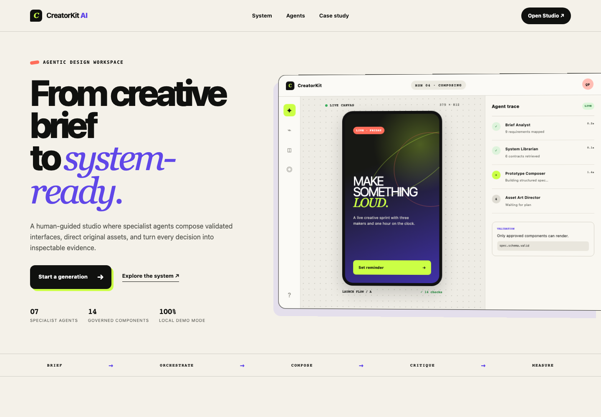
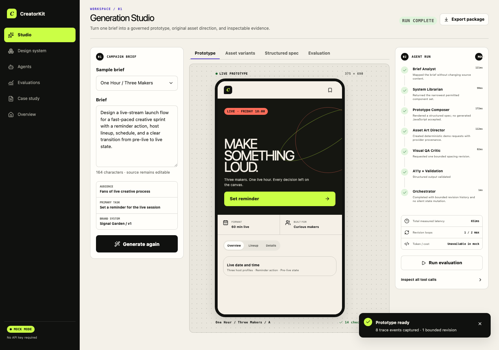
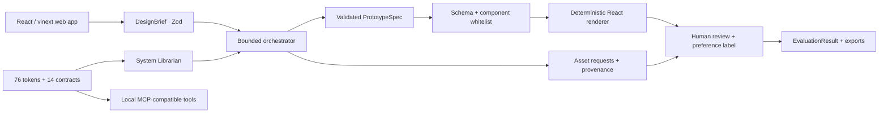
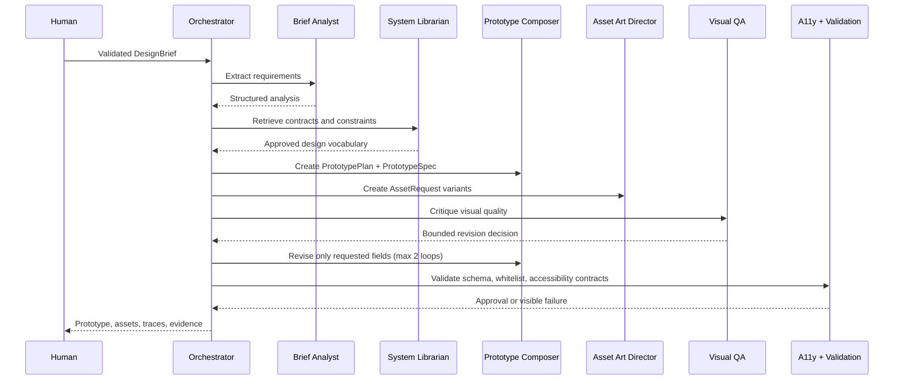
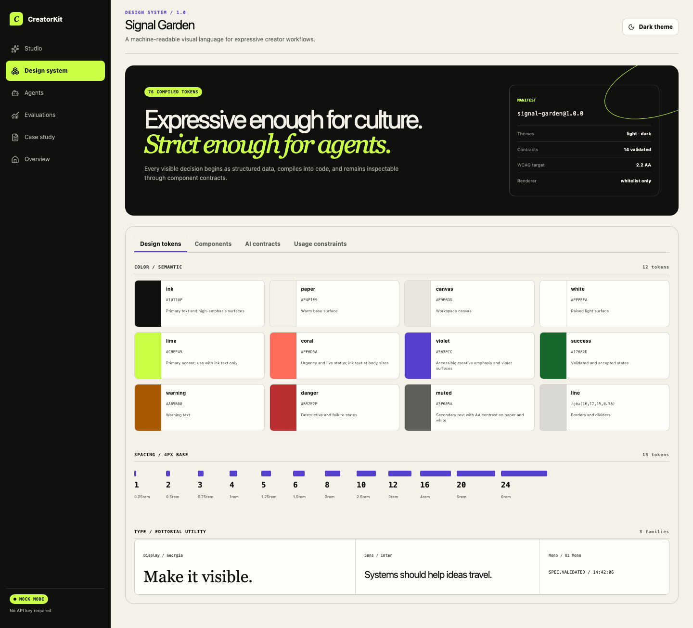

# CreatorKit AI

**Agentic Design System & Generative Asset Studio**

CreatorKit AI is a portfolio-grade internal design tool for creator and short-form content teams. A brief moves through seven schema-governed specialist agents, becomes a deterministic interactive prototype, receives original asset direction, and ends as inspectable evaluation evidence—without executing model-generated JavaScript.

The default experience is fully local and deterministic. No API key is required.



## Product problem

AI can make UI quickly, but ungoverned output drifts from tokens, invents components, hides decisions, and turns visual review into anecdote. CreatorKit treats generation as a design-engineering pipeline: structured brief → machine-readable system → validated spec → whitelisted renderer → human and automated evidence.

## Key features

- Four creator-oriented sample briefs covering a campaign page, live-stream launch, short-video template, and creator campaign card.
- Seven specialist agent roles with ordered status, structured I/O, tool calls, validation failures, latency, revision decisions, and provider usage fields.
- A two-loop revision ceiling enforced by the orchestrator.
- Signal Garden, an original light/dark system with 76 compiled tokens, 14 reusable React components, 14 Zod-validated component contracts, and Storybook documentation.
- Deterministic `PrototypeSpec` rendering from a strict approved-component whitelist.
- Original ImageGen campaign art plus deterministic local asset variants, prompt history, aspect ratios, approval/rejection, regeneration, and export.
- Human A/B preference labeling with six aesthetic dimensions, local provenance-aware storage, and JSONL export.
- Evaluation dashboard and Markdown/JSON artifact export with explicit “Not measured” fallbacks.
- MCP-compatible local tool surface for tokens, components, contracts, patterns, and spec validation.



## Architecture



The repository keeps product UI and domain packages separate:

```text
app/                              required product pages and API route
packages/design-tokens/           JSON source + CSS/TypeScript/docs compiler
packages/design-system/           components, styles, contracts, stories
packages/shared-schemas/          shared Zod contracts
packages/agent-workflows/         mock orchestrator + optional provider adapter
packages/design-system-mcp/       local JSON-lines tool server
packages/evaluation/              reproducible spec/evidence evaluation
tests/                            unit, component, integration, MCP, E2E, axe
docs/                             architecture, methodology, case study, screenshots
training/                         optional preference-ranking preparation
```

See [docs/architecture.md](docs/architecture.md) and [docs/agent-workflow.md](docs/agent-workflow.md) for the full design.

## Agent workflow



## Design-system architecture

`packages/design-tokens/src/tokens.json` is the source of truth. `pnpm tokens:build` compiles it into:

- `generated/tokens.css` for runtime custom properties and themes;
- `generated/tokens.ts` for typed programmatic access;
- `generated/tokens.md` for human documentation;
- `generated/design-system-manifest.json` for agents and tooling.

Components consume these tokens and expose machine-readable contracts with variants, props, token references, accessibility rules, valid/invalid examples, and composition constraints. The MCP-compatible tools serve the same source data, preventing prompt-only drift.



## Local setup

Prerequisites: Node.js `>=22.13` and pnpm.

```bash
pnpm install
pnpm tokens:build
pnpm dev
```

Open [http://localhost:3000](http://localhost:3000). Storybook runs separately:

```bash
pnpm storybook
```

Docker is supported for mock mode:

```bash
docker compose up --build
```

## Environment variables

Copy `.env.example` to `.env.local`. The safe default is:

```dotenv
CREATOR_KIT_AI_PROVIDER=mock
```

Optional provider mode uses `CREATOR_KIT_AI_PROVIDER=openai`, `CREATOR_KIT_AI_MODEL`, and `OPENAI_API_KEY`. The server adapter applies a 24-second timeout, one retry, a 2,400-output-token ceiling, `store: false`, JSON parsing, and Zod validation. Provider cost stays `null` when the API does not return price data. The Studio remains in mock mode unless provider mode is explicitly requested through the workflow API.

Never commit a populated key.

## Testing

```bash
pnpm validate          # tokens, strict TypeScript, ESLint, Vitest
pnpm test:integration # workflow and MCP tool smoke tests
pnpm test:e2e         # journey, axe, keyboard, responsive, visual regression
pnpm test:html        # production-rendered route checks after build
pnpm storybook:build
pnpm build
pnpm screenshots
```

### Latest local evidence — 2026-08-21

| Evidence | Measured result |
| --- | --- |
| Vitest | 17/17 passed across 6 files |
| MCP tool smoke tests | 5/5 passed |
| Browser E2E | 12/12 passed |
| axe-core | 0 violations across all 6 required pages and the completed main flow |
| Keyboard behavior | 2/2 checks passed (component + real-browser tab navigation) |
| Responsive layout | 18/18 route×viewport overflow checks passed |
| Visual regression | 1/1 Chromium reference passed |
| Production HTML | 3/3 route assertions passed |
| Token compliance | 15/15 generated spec references, 100% |
| Approved components in fixture | 5 valid / 0 invalid |
| Production build | Pass |
| Human preference rate | Not measured—no user study dataset exists |
| Business conversion or revenue | Not measured—hypothetical downstream metrics only |

Generation latency in the UI is measured per local run and varies with the machine. Mock token and cost fields are explicitly unavailable rather than estimated.

## MCP-compatible design-system tools

Run the JSON-lines server:

```bash
pnpm exec tsx packages/design-system-mcp/src/server.ts
```

Example request:

```json
{"id":1,"tool":"get_component_contract","input":{"name":"Button"}}
```

Available tools: `list_design_tokens`, `list_components`, `get_component_contract`, `search_design_patterns`, and `validate_prototype_spec`. See [docs/agent-workflow.md](docs/agent-workflow.md) for Codex, Cursor, and Claude Code integration guidance.

## Limitations

- Browser data uses local storage; there is no collaborative account sync.
- The optional OpenAI adapter produces structured plans, specs, critiques, and asset prompts but does not call a paid image endpoint by default.
- Deterministic assets are development fixtures; only explicit user submissions count as human labels.
- Docker support is provided, but the image build is not part of the current measured suite when Docker is unavailable.
- No LoRA training was run and no model-quality improvement is claimed.

## Roadmap

- Add a provider selector and streaming trace updates to the Studio.
- Add SQLite-backed multi-run history and dataset versioning.
- Connect a licensed image-generation provider behind the existing `AssetRequest` contract.
- Run a consented creator-team preference study and populate held-out ranking metrics.
- Add cross-browser visual baselines and hosted CI artifacts.

## Portfolio narrative

Read [docs/case-study.md](docs/case-study.md), [docs/ai-assisted-development.md](docs/ai-assisted-development.md), and [docs/resume-bullets.md](docs/resume-bullets.md). The in-product `/case-study` page presents the same story as an interactive portfolio surface.

This project uses an original identity and assets. It does not copy TikTok UI, branding, logos, or proprietary product patterns.
