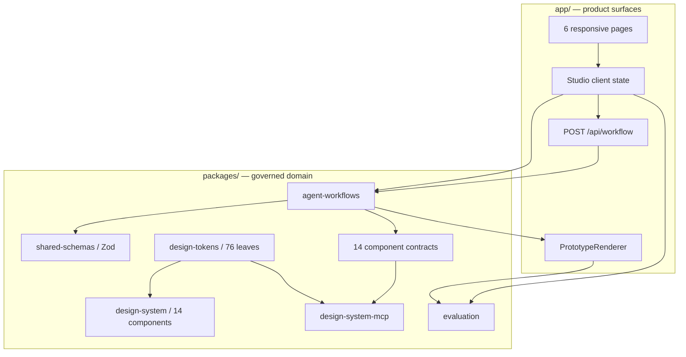

# Architecture

## System boundary

CreatorKit AI is a TypeScript-first local web application. The app router owns presentation and the provider API; domain packages own schemas, contracts, orchestration, tools, and evaluation. Mock mode is the reference implementation and never requires network access.

## Main data path

1. A selected sample or edited brief is parsed by `DesignBriefSchema`.
2. The mock orchestrator passes immutable structured state through seven roles.
3. The librarian narrows the available components and tokens.
4. The composer returns `PrototypePlan` and `PrototypeSpec`, never code.
5. Zod and the component map reject invalid structure or unknown components.
6. `PrototypeRenderer` maps whitelisted block names to owned React implementation.
7. Asset requests retain prompt, aspect ratio, palette, parameters, provider, and provenance.
8. The user can approve/reject/regenerate, create a human preference label, run evaluation, and export the result.

## Trust and safety boundary

Generated output is data. There is no `eval`, dynamic script injection, or arbitrary component import. Unknown component names fail validation and cannot reach the renderer. Provider responses are parsed as JSON, passed through Zod, and returned as structured API output. The mock path records null provider usage rather than inventing tokens or cost.

Secrets remain server-side. `.env*` is ignored except the blank `.env.example`; provider requests use `store: false`, a 24-second timeout, one retry, and a bounded output size.

## State and persistence

- Workflow state is scoped to the active Studio client run.
- Human preference labels and the latest evaluation are stored in browser local storage.
- Exports are explicit downloads: artifact JSON, asset JSON, evaluation Markdown, and human-label JSONL.
- Synthetic critiques and demo assets carry explicit provenance and never enter the human-label count.

Local storage keeps the portfolio runnable with no services. A production collaboration version would replace this layer with SQLite or a service database while preserving the same schemas.

## Rendering and runtime

The web app uses React 19, strict TypeScript, Tailwind’s build pipeline, and vinext for the Next-compatible app runtime. Storybook runs through Vite with the product runtime plugin disabled. The production bundle is emitted to `dist/` and Docker starts the same built application in mock mode.

## Failure behavior

- Invalid brief: visible inline validation failure; source brief stays unchanged.
- Provider not configured: `503` with setup guidance.
- Provider timeout/non-JSON/schema mismatch: bounded failure returned from the API.
- Invalid component or token reference: validator issues included in evaluation/tool output.
- Partial agent failure: trace status and validation failures are designed to remain inspectable; unrelated state is not silently mutated.

## Key tradeoffs

- **Determinism over free-form canvas code.** Lower generative freedom buys auditability, safety, and design-system compliance.
- **Local persistence over collaboration infrastructure.** The visible workflow and evaluation are complete; multi-user sync remains a clear extension point.
- **Structured local tool interface over a large MCP SDK dependency.** The five tools are transport-light, smoke-tested, and easy to wrap in standard MCP transports later.
- **Measured fixture evidence over invented product impact.** Technical checks are real; business conversion remains explicitly hypothetical.
